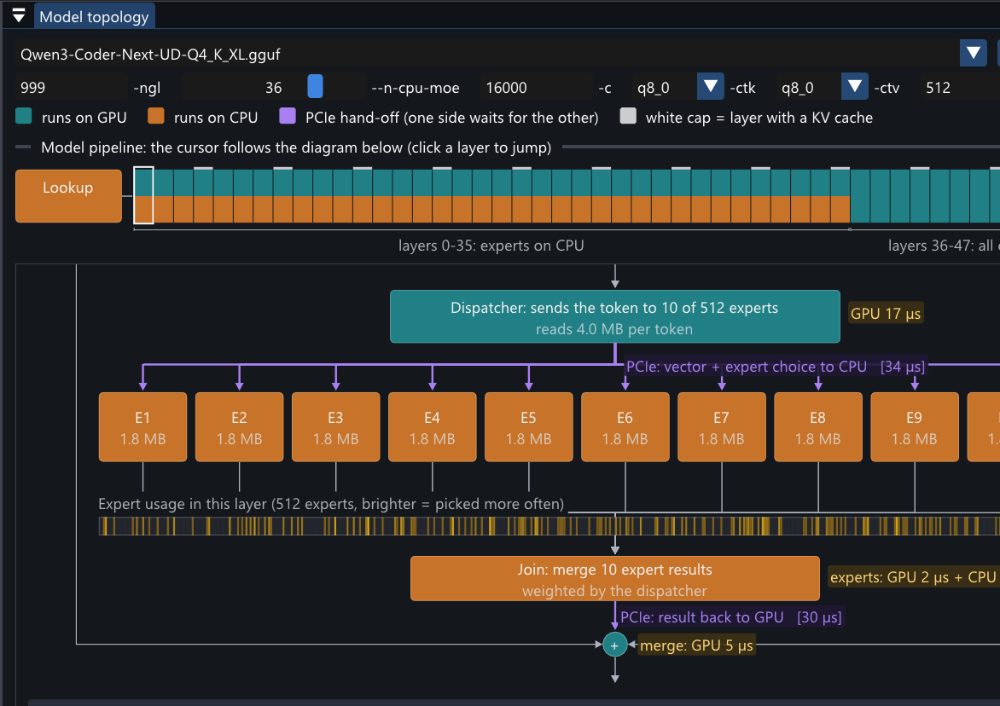
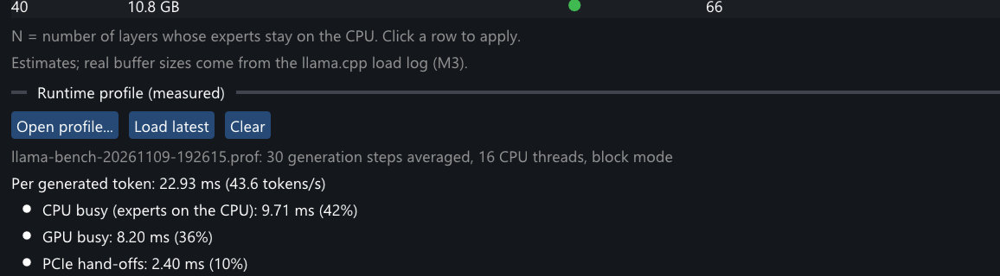
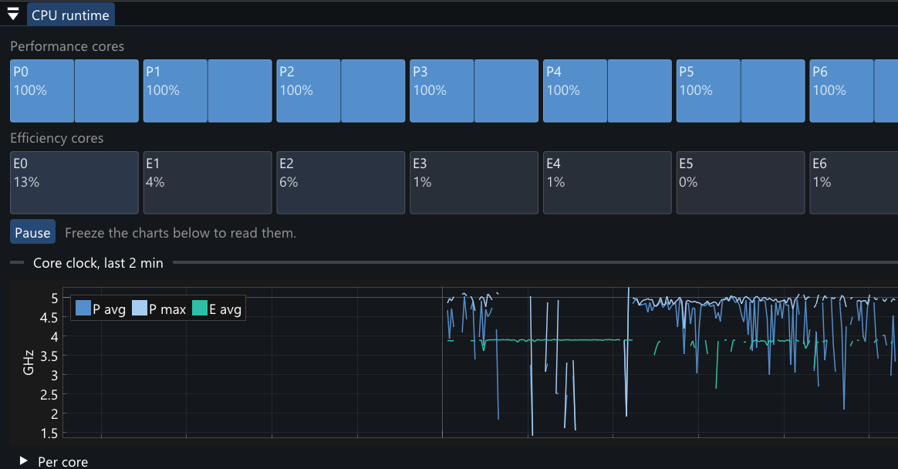
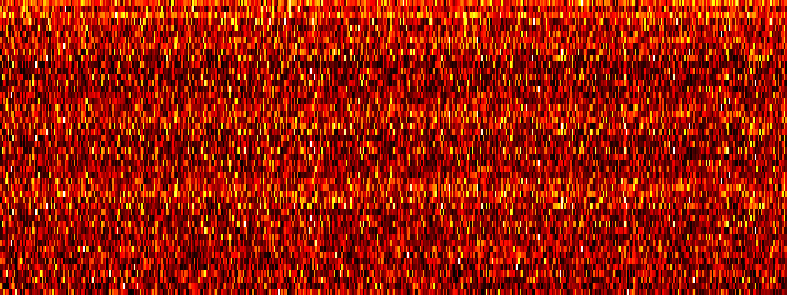

# LlamaScope

One-screen diagnostics for local LLM inference with [llama.cpp](https://github.com/ggml-org/llama.cpp) on Windows (NVIDIA GPU + Intel CPU). It shows, in one window:

- **Hardware checks:** what does not run at spec (memory speed and bandwidth, PCIe link width and copy speed, all-core clocks, power plan, core parking, hardware-accelerated GPU scheduling, monitors on the inference GPU, lock-pages privilege). One "Run tests" button measures and refreshes everything.
- **Model topology:** the GGUF model drawn as a system diagram (context stage with its KV cache or state store, dispatcher, experts, always-on expert, merges), what runs on the GPU and what on the CPU for your `-ngl` / `--n-cpu-moe`, the VRAM budget, a bandwidth ceiling and a what-if table for `--n-cpu-moe`.
- **CPU and GPU runtime:** per-core load and clocks, live DRAM read/write traffic (memory-controller counters), GPU utilization, clocks, PCIe traffic and which programs hold VRAM on the inference GPU.
- **Runtime profile:** measured time per block, CPU/GPU hand-off latency and expert usage per layer, drawn on the model diagram, recorded by a profiler built into a fork of llama.cpp (see below).
- **Inference mode:** session-scoped de-bloat (background programs to E-cores, services and maintenance tasks paused, power settings) with a journaled restore.
- **Diagnosis:** persistent findings such as GPU throttling, VRAM spill, memory-bandwidth saturation, room for more expert layers on the GPU.







Expert usage across 2000 benchmark prompts (rows = 48 layers, columns = 512 experts; first image by expert index, second image with each layer's experts sorted by usage), from [docs/EXPERTS.md](docs/EXPERTS.md):




## Requirements

- Windows 10/11 x64, NVIDIA GPU with a current driver, Intel CPU (hybrid P/E-core CPUs are handled explicitly).
- To build: Visual Studio 2022 or 2026 with the C++ x64 tools, CMake, Ninja (both ship with Visual Studio).
- Optional: administrator rights (Inference mode, live memory traffic), Intel VTune (its `emon.exe` and sampling driver provide the live DRAM traffic chart).

## Build

```
git clone https://github.com/ai-jetpack/lamascope.git
cd lamascope
build.cmd            # Release -> build\Release\LlamaScope.exe
build.cmd Debug
```

The output is a single statically linked exe (~2 MB) that depends only on DLLs shipped with Windows; NVIDIA data comes from `nvml.dll` / `nvcuda.dll`, loaded at runtime from the driver.

## Run

```
build\Release\LlamaScope.exe
```

Run it as administrator for Inference mode and the live memory-traffic chart. In the **Model topology** panel, pick your `.gguf` (it scans `Downloads\models`, `models`, `C:\models`, or use Browse) and enter the flags you run llama.cpp with. In the **Hardware** panel, press **Run tests** while llama.cpp is not running.

Settings, layout, profiles and the log live in `%LOCALAPPDATA%\LlamaScope\`.

Command-line options:

| option | effect |
|---|---|
| `--profile <file>`, `--profile-latest` | open a runtime profile at startup |
| `--profile-dump <file>` | headless: log the profile aggregation to `llamascope.log` |
| `--run-tests` | press Run tests 5 s after startup |
| `--snapshot <png> [--snapshot-after <s>] [--topology-scroll <layer.frac>] [--summary-scroll <frac>]` | render, save a screenshot of the window, exit (works with the monitors off) |
| `--selftest`, `--im-roundtrip [--memtest]`, `--imc-probe` | headless checks |
| `--no-nvml --no-imc --no-pdh-all --no-pdh-gpu --no-procmon` | turn off individual collectors (to measure their cost) |

## Recording a runtime profile

Stock llama.cpp exposes no per-block timing or expert choices, so the profiler lives in a fork: branch [`llamascope-profiler`](https://github.com/ai-jetpack/llama.cpp/tree/llamascope-profiler) of `ai-jetpack/llama.cpp`. It is off unless `GGML_PROFILE` is set; when on, it costs ~0% for the CPU timing and ~1-1.5% generation speed for the GPU timing (measured, [docs/PROFILER.md](docs/PROFILER.md)).

**1. Build the profiler-enabled llama.cpp** (needs the CUDA toolkit; run from an "x64 Native Tools Command Prompt for VS"):

```
git clone https://github.com/ai-jetpack/llama.cpp.git llama.cpp-prof
cd llama.cpp-prof
git checkout llamascope-profiler
cmake -S . -B build-prof -G Ninja -DCMAKE_BUILD_TYPE=Release -DGGML_CUDA=ON -DCMAKE_CUDA_ARCHITECTURES=native ^
      -DGGML_OPENMP=ON -DGGML_NATIVE=ON -DBUILD_SHARED_LIBS=ON -DLLAMA_CURL=OFF -DLLAMA_BUILD_SERVER=ON
cmake --build build-prof --target llama-cli llama-bench llamascope-batch
```

(`LLAMA_BUILD_SERVER=ON` is needed because `llama-cli` shares code with the server.)

**2a. From LlamaScope:** in **Model topology**, paste your llama-cli command line and press **Apply**. Press **Profiling setup...** next to **Run profiling** and set the `build-prof\bin` folder (and the CUDA `bin` folder if its DLLs are not on PATH). Then press **Run profiling**. It turns on Inference mode (when LlamaScope runs as administrator) and starts llama-cli from the profiler build in its own window with all cores available. Type your prompts there and end with `/exit`, or add `-p "<prompt>" -n <tokens> -st` for a single non-interactive turn. When llama-cli exits, LlamaScope loads the profile and restores Inference mode. The executable named in the pasted line is ignored: it always runs `llama-cli`.

**2b. Or run llama-cli through the helper script** (PowerShell, from the LlamaScope folder):

```
$env:LLAMACPP_PROF_BIN = "<path>\llama.cpp-prof\build-prof\bin"
$env:CUDA_BIN          = "<CUDA toolkit>\bin"        # if the CUDA runtime DLLs are not on PATH
.\scripts\Profile-Llama.ps1 -m <model.gguf> -ngl 999 --n-cpu-moe 36 ...   # your usual llama-cli flags
```

Use llama-cli as usual and leave with `/exit` (a double Ctrl+C skips the cleanup that saves the GPU part of the profile). The profile is written to `%LOCALAPPDATA%\LlamaScope\profiles\llama-cli-<time>.prof` and LlamaScope opens it automatically. Script options: `--profile-tool=llama-bench`, `--profile-mode=op` (one record per operation instead of per block), `--profile-view=0` (do not open LlamaScope).

**3. Read it:** in **Model topology**, every layer shows measured GPU/CPU time per block, the latency of each CPU<->GPU hand-off and an expert-usage strip; the **Runtime profile** section shows where each token's time goes (CPU, GPU, hand-offs, other), the copied tensors, and a layers x experts usage heatmap. Open older profiles with **Open profile...** or `LlamaScope.exe --profile <file>`.

Without the script: set `GGML_PROFILE=block` (or `op`) and `GGML_PROFILE_FILE=<path>.prof` before starting any llama.cpp tool from that build; `GGML_PROFILE_TRACE=1` additionally records the experts picked per generated token and layer.

## Documentation

| | |
|---|---|
| [docs/PRD.md](docs/PRD.md), [docs/DESIGN.md](docs/DESIGN.md) | product requirements and design, measured findings (§18) |
| [docs/PROFILER.md](docs/PROFILER.md) | in-process profiler: design, file format, measured cost |
| [docs/EXPERTS.md](docs/EXPERTS.md) | expert-usage study over 2000 benchmark prompts; static vs. runtime expert placement |
| [docs/CPU-EXPERT-BANDWIDTH.md](docs/CPU-EXPERT-BANDWIDTH.md) | why the CPU expert phase reaches ~84% of the measured memory bandwidth |
| [docs/DECISIONS-2026-11-09.md](docs/DECISIONS-2026-11-09.md) | decision log of the profiler work |
| `scripts/expert-study/`, `scripts/expertbw/` | study and benchmark scripts |

## Status

| Milestone | State |
|---|---|
| M0 Feasibility spikes (DxgKrnl, ETW overhead, HWiNFO) | done |
| M1 Hardware panel ("Run tests", checks vs spec, Platform details), CPU/GPU runtime panels | done |
| M5 Model topology: GGUF reader, placement, pipeline diagram, VRAM budget, `--n-cpu-moe` what-if | done |
| M2b Inference mode: session-scoped de-bloat, background programs on E-cores, journaled restore | done |
| Live DRAM traffic, VRAM holders, diagnosis rules (HAGS, core parking, VRAM room, bandwidth) | done |
| Runtime profiler (llama.cpp fork) + profile view on the diagram, expert-usage study | done |
| M2 Tools & Setup, llama.cpp build manager, installers | next |
| M3 Launcher, run history + diff | planned |
| M4 ETW thread placement, CPU time by module | planned |

## Third-party (vendored in `third_party/`)

Dear ImGui 1.93.0-docking, ImPlot 1.1, nlohmann/json 3.12.0, miniz 3.1.2 (all MIT).
